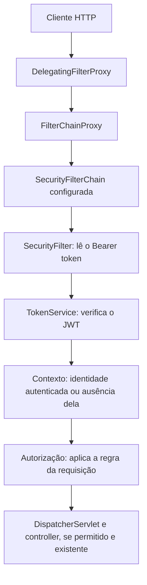

# Autenticação e autorização: entendendo a segurança deste projeto

Este relatório explica o código de `src/main/java/br/edu/infnet/backend/config` e as classes de domínio que o sustentam. A análise foi feita em 13/11/2026 por leitura do código, sem executar a aplicação. O `pom.xml` declara Spring Boot 4.1.2, Java 21, Spring Security e a biblioteca Auth0 `java-jwt` 4.4.0. As referências oficiais ao longo do texto apoiam os conceitos; não representam uma validação das dependências resolvidas em execução.

**O projeto prepara uma API com JWT e sem sessão de autenticação no servidor. Há regras de acesso e um filtro que reconhece tokens, mas o ciclo de cadastro e login ainda não está completo.** Vamos estudar tanto a arquitetura pretendida quanto o comportamento que o código permite afirmar hoje.

## 1. Primeiro, duas perguntas diferentes

Imagine a biblioteca da instituição:

- **Autenticação:** “Quem é você?” No login, o sistema deve verificar e-mail e senha. Nas próximas requisições, verifica um token que representa uma identidade previamente autenticada.
- **Autorização:** “O que você pode fazer?” Um aluno pode, por exemplo, consultar livros, enquanto um funcionário pode ter permissão para cadastrar exemplares. Essa distinção é um exemplo didático; ela ainda não está implementada aqui.

No projeto, a autorização atual distingue principalmente **requisições públicas** de **requisições que exigem alguém autenticado**. O enum `TipoUsuario` contém `ALUNO`, `PROFESSOR` e `FUNCIONARIO`, mas esses valores ainda não participam das decisões de acesso.

Ter uma identidade reconhecida e ter permissão para uma operação são decisões distintas. Essa separação é a base para entender o restante do código.

## 2. Mapa das peças

| Peça | Responsabilidade nesta implementação |
| --- | --- |
| [`SecurityConfig`](src/main/java/br/edu/infnet/backend/config/SecurityConfig.java) | Monta a cadeia de segurança, define acesso às rotas e fornece beans de autenticação e senha. |
| [`SecurityFilter`](src/main/java/br/edu/infnet/backend/config/SecurityFilter.java) | Extrai o Bearer token e registra a identidade no contexto da requisição quando a validação passa. |
| [`TokenService`](src/main/java/br/edu/infnet/backend/config/TokenService.java) | Emite JWTs assinados e verifica tokens recebidos. |
| [`JWTUserData`](src/main/java/br/edu/infnet/backend/config/JWTUserData.java) | Transporta `userId` e `email`; é a identidade usada pelo filtro. |
| [`AuthService`](src/main/java/br/edu/infnet/backend/config/AuthService.java) | Implementa `UserDetailsService`: procura o usuário pelo e-mail. |
| [`CorsConfig`](src/main/java/br/edu/infnet/backend/config/CorsConfig.java) | Define quais acessos entre origens o navegador pode realizar. |
| [`Usuario`](src/main/java/br/edu/infnet/backend/domain/entity/Usuario.java) | Entidade JPA que também implementa o contrato `UserDetails`. |
| [`UserRepository`](src/main/java/br/edu/infnet/backend/domain/repository/UserRepository.java) | Consulta a persistência, incluindo a busca por e-mail. |

`@Configuration` identifica classes de configuração. Métodos com `@Bean` entregam objetos gerenciados pelo Spring. `@Component` e `@Service` também tornam classes gerenciadas. `@RequiredArgsConstructor`, do Lombok, gera o construtor para os campos `final`, permitindo injetar dependências como `SecurityFilter` e `UserRepository`.

Observe a composição: o filtro depende do serviço de tokens; o serviço de busca depende do repositório. Cada peça tem uma tarefa e colabora com as demais.

## 3. Por que o Spring Security usa filtros?

Uma requisição passa por filtros antes de chegar ao controller. Um filtro pode examinar cabeçalhos, preparar informações ou encerrar o processamento. `filterChain.doFilter(request, response)` entrega a requisição ao próximo elemento.

Na arquitetura Servlet, `DelegatingFilterProxy` conecta o container aos beans do Spring. Ele delega ao `FilterChainProxy`, que seleciona uma `SecurityFilterChain`. A cadeia contém os filtros de segurança; depois deles, o `DispatcherServlet` encaminha a chamada ao controller. A ordem dos filtros determina quais informações estarão disponíveis para as etapas seguintes. [Referência: arquitetura Servlet do Spring Security](https://docs.spring.io/spring-security/reference/servlet/architecture.html).

Este é um desenho simplificado do caminho relevante no projeto, não uma listagem completa dos filtros internos:



Em `SecurityConfig`, esta instrução posiciona o filtro personalizado:

```java
.addFilterBefore(securityFilter, UsernamePasswordAuthenticationFilter.class)
```

Ela usa a posição do filtro de usuário/senha como referência de ordenação. **Não cria um endpoint de login e não faz o filtro personalizado receber e-mail e senha.** Nesta implementação, ele só procura JWT no cabeçalho.

## 4. Lendo `SecurityConfig` como uma política de acesso

### 4.1. As regras e sua ordem

As regras são avaliadas na ordem declarada; a primeira correspondente determina a exigência aplicável. `permitAll()` dispensa autenticação para aquela regra, e `authenticated()` exige uma autenticação reconhecida pelo Spring. [Referência: autorização de requisições](https://docs.spring.io/spring-security/reference/servlet/authorization/authorize-http-requests.html).

| Ordem | Requisição correspondente | Regra |
| --- | --- | --- |
| 1 | Dispatch interno do tipo `ERROR` | Público. |
| 2 | `OPTIONS /**` | Público. |
| 3 | `POST /auth/login` | Público. |
| 4 | `POST /auth/register` | Público. |
| 5 | `HEAD /auth/validate` | Exige autenticação. |
| 6 | Qualquer outra requisição | Exige autenticação. |

A liberação de `ERROR` permite processar encaminhamentos internos de erro. Ela não equivale a liberar qualquer chamada externa para `/error`: uma chamada normal tem outro tipo de dispatch.

Os métodos HTTP fazem parte da regra. `GET /auth/login`, por exemplo, cai na regra final. A linha de `HEAD /auth/validate` explicita uma intenção, mas exige a mesma autenticação que a regra final já exigiria.

**Liberar uma rota não implementa a rota.** Não foram encontrados controllers no código-fonte analisado. Portanto, `/auth/login`, `/auth/register` e `/auth/validate` aparecem como políticas de segurança, sem handlers implementados. Mesmo autorizado, um pedido ainda depende de existir um endpoint para atendê-lo. A documentação Swagger também não recebeu exceção pública e fica sujeita à regra final.

`permitAll()` também não elimina os filtros anteriores. O `SecurityFilter` continua podendo examinar o token de uma chamada pública; é a exigência de autenticação daquela rota que está dispensada.

### 4.2. O significado de `STATELESS`

```java
.sessionManagement(session ->
    session.sessionCreationPolicy(SessionCreationPolicy.STATELESS))
```

A política impede o Spring Security de usar a sessão HTTP para conservar a autenticação entre requisições. O cliente precisa apresentar novamente a credencial, aqui o JWT, a cada acesso protegido.

Isso não significa ausência de estado em todo o sistema: usuários continuam no banco, e há uma identidade disponível durante o processamento de uma chamada. O que não se mantém é uma sessão de login usada pelo Spring Security para reconhecer a próxima chamada.

### 4.3. CSRF e CORS resolvem problemas diferentes

O código desabilita CSRF com `.csrf(csrf -> csrf.disable())`. CSRF envolve o navegador enviar credenciais automaticamente em uma requisição induzida por outro site. Desabilitá-lo pode ser adequado em uma API cuja credencial é enviada explicitamente no cabeçalho `Authorization`. **Ser stateless, sozinho, não elimina CSRF**: se a autenticação passar a depender de cookies enviados automaticamente, a decisão deve ser reavaliada. [Referência: proteção CSRF](https://docs.spring.io/spring-security/reference/servlet/exploits/csrf.html).

`CorsConfig` permite todas as origens e todos os cabeçalhos para `/**`. Os métodos listados são `GET`, `POST`, `PUT`, `DELETE`, `OPTIONS`, `HEAD`, `TRACE` e `CONNECT`; `PATCH` não está na lista. Não há habilitação de credenciais CORS por `allowCredentials(true)`.

CORS controla acessos entre origens feitos pelo navegador. Ele não autentica usuários nem cria endpoints. Permitir um método no CORS não garante que exista um controller ou que o servidor aceite esse método. O preflight `OPTIONS` consulta as permissões antes da requisição efetiva, que ainda precisa cumprir as regras de segurança.

O Spring Security pode aproveitar a configuração CORS do Spring MVC. A forma documentada para ativar essa integração é `.cors(Customizer.withDefaults())`. O projeto usa `.cors(cors -> cors.configure(http))`, chamando diretamente uma etapa do configurador. Convém substituí-la pela forma documentada e verificar o preflight em execução; a leitura estática aqui não comprova uma falha de CORS. [Referência: integração CORS](https://docs.spring.io/spring-security/reference/servlet/integrations/cors.html).

## 5. Login com e-mail e senha: o caminho preparado

O fluxo abaixo explica como as peças existentes deveriam ser conectadas. **Ele ainda não é um fluxo completo disponível na aplicação.**

```text
POST /auth/login com e-mail e senha
  -> controller de login [a implementar]
  -> AuthenticationManager.authenticate(...)
  -> provider de autenticação de usuário/senha
  -> AuthService.loadUserByUsername(email)
  -> UserRepository.findByEmail(email)
  -> Usuario como UserDetails
  -> PasswordEncoder compara senha recebida e hash armazenado
  -> autenticação bem-sucedida
  -> TokenService.generateToken(usuario)
  -> resposta com o JWT [a implementar]
```

### 5.1. Quem verifica a senha?

`AuthenticationManager` é o contrato para solicitar uma autenticação. Uma implementação comum, `ProviderManager`, delega a providers especializados. Para usuário e senha, `DaoAuthenticationProvider` utiliza `UserDetailsService` para obter os dados e `PasswordEncoder` para verificar a senha. A combinação dos beans locais é compatível com essa integração padrão, mas não há provider explicitamente construído no projeto nem chamada de login para demonstrá-la em execução. [Referência: DaoAuthenticationProvider](https://docs.spring.io/spring-security/reference/servlet/authentication/passwords/dao-authentication-provider.html).

O bean de `SecurityConfig` obtém o manager de `AuthenticationConfiguration`. Publicar esse bean permite injetá-lo em outro componente; não executa autenticação por si só.

`AuthService` implementa somente a busca:

```java
return userRepository.findByEmail(username)
    .orElseThrow(() -> new UsernameNotFoundException(username));
```

Aqui, `username` é o e-mail. O método não recebe senha e não emite JWT. A responsabilidade de `UserDetailsService` é fornecer dados para a autenticação, e não decidir sozinho se a senha recebida está correta. [Referência: UserDetailsService](https://docs.spring.io/spring-security/reference/servlet/authentication/passwords/user-details-service.html).

### 5.2. O papel de `Usuario` e o problema atual

`Usuario` implementa `UserDetails`, adaptando a entidade ao contrato do Spring Security:

- `getUsername()` retorna o e-mail.
- `getPassword()` deveria retornar o hash persistido, mas retorna `null`.
- `getAuthorities()` deveria retornar uma coleção de permissões, ainda que vazia, mas retorna `null`.
- Os quatro métodos de estado da conta retornam `true`: não há bloqueio ou expiração representados por esses métodos.

Embora exista um campo `password`, o método escrito explicitamente retorna `null`. O Lombok não substitui esse método por um getter que retorne o campo. Assim, o caminho padrão não recebe o hash necessário à comparação. O login por senha não fica funcional apenas por haver `AuthService` e `PasswordEncoder`.

### 5.3. BCrypt: guardar um hash, comparar uma senha

O bean `PasswordEncoder` usa `BCryptPasswordEncoder`. BCrypt produz um hash de mão única com salt e custo computacional; não se “descriptografa” a senha no login. No cadastro, deve-se persistir `passwordEncoder.encode(senhaRecebida)`. Na verificação, usa-se `passwordEncoder.matches(senhaRecebida, hashArmazenado)`, normalmente pelo provider. Gerar outro hash e comparar strings não é a operação correta, porque o salt pode produzir resultados diferentes para a mesma senha. [Referência: armazenamento de senhas](https://docs.spring.io/spring-security/reference/features/authentication/password-storage.html).

Essas operações descrevem o uso esperado: não há cadastro implementado que chame `encode` no código analisado.

## 6. JWT: como `TokenService` emite e verifica a credencial

### 6.1. Emissão

`generateToken(Usuario usuario)` usa `Algorithm.HMAC256(secret)` e configura:

| Dado | Conteúdo emitido |
| --- | --- |
| `sub` — subject | E-mail de `usuario`. |
| `exp` — expiration | Instante atual mais 3.600 segundos: uma hora. |
| `iat` — issued at | Instante de emissão. |
| Assinatura | HMAC-SHA256 com o segredo configurado. |

Um JWT assinado tem cabeçalho, payload e assinatura. A assinatura permite verificar integridade e autenticidade com a chave adequada; ela não torna o payload confidencial. Não se deve colocar senhas no token. Neste uso de HMAC, a mesma chave permite assinar e verificar. Quem obtiver essa chave pode emitir tokens aceitos pelo verificador. A biblioteca Auth0 fornece as operações de criação e verificação usadas no projeto. [Referência: java-jwt](https://github.com/auth0/java-jwt).

O segredo vem de `biblioteca.flix.security.secret`, em `application.properties`. Há um valor literal no arquivo; para uma implantação real, deve ser externalizado e ter entropia adequada. Não é necessário reproduzi-lo para entender o mecanismo.

**Assinar um token não verifica senha.** `generateToken` aceita um `Usuario` e assina seus dados; cabe ao fluxo que o chama garantir que a autenticação anterior realmente ocorreu.

### 6.2. Validação

`validateToken` constrói um verificador com o mesmo algoritmo e segredo, chama `verify(token)` e transforma o resultado em `JWTUserData`. O verificador confere a assinatura e as restrições temporais aplicáveis, incluindo a expiração emitida aqui. Uma `JWTVerificationException` resulta em `Optional.empty()`.

Existe uma inconsistência concreta: a emissão **não inclui a claim `userId`**, mas a validação faz `decode.getClaim("userId").asLong()`. Para os tokens gerados por este serviço, o ID resultante é `null`. Isso não invalida automaticamente a assinatura nem impede `authenticated()`, mas pode prejudicar código que dependa desse identificador.

Uma correção possível seria incluir `.withClaim("userId", usuario.getId())` na emissão, se o ID for realmente necessário ao contrato. Outra seria retirar esse campo do contrato e usar uma identidade definida de forma consistente. São sugestões; este relatório não altera o código.

O serviço também não exige explicitamente issuer, audience ou presença de subject e ID. Portanto, “o token passou no verificador” não equivale a “todos os dados de identidade exigidos pelo domínio foram validados”. Esses requisitos precisam ser definidos e verificados pela aplicação.

## 7. A requisição protegida, passo a passo

Suponha que exista um endpoint `GET /livros` e que o cliente já tenha obtido um token válido. O caminho e a rota são exemplos didáticos, não um controller encontrado no projeto.

```http
GET /livros HTTP/1.1
Authorization: Bearer <token>
```

O `SecurityFilter`, que estende `OncePerRequestFilter`, executa esta sequência no processamento normal:

1. Lê o cabeçalho `Authorization`.
2. Verifica se ele não está vazio e se começa exatamente com `Bearer `.
3. Retira o prefixo e entrega o token a `TokenService.validateToken`.
4. Se houver `JWTUserData`, constrói um objeto `Authentication` e o coloca no contexto.
5. Chama `filterChain.doFilter`, permitindo que as próximas etapas decidam o acesso.

Se o cabeçalho não existir, tiver outro prefixo ou o token for inválido/expirado, o filtro simplesmente continua sem estabelecer uma identidade. Ele não escreve diretamente uma resposta de erro. Em rota pública isso pode ser permitido; em rota protegida, faltará a autenticação exigida.

Os dois ramos do `if` chamam `filterChain.doFilter`. Não há duas chamadas na mesma passagem: cada ramo é mutuamente exclusivo. É possível simplificar essa repetição, mas ela não representa, por si só, uma execução dupla.

### 7.1. O detalhe importante do construtor

```java
new UsernamePasswordAuthenticationToken(userData, null, null);
```

Neste construtor de três argumentos:

- `principal` é `userData`: a identidade reconhecida.
- `credentials` é `null`: a senha não participa dessa etapa.
- `authorities` é `null`: o objeto fica sem permissões atribuídas.

O construtor de três argumentos cria um token marcado como autenticado; o de dois argumentos representa inicialmente uma solicitação ainda não autenticada. O nome da classe não significa que uma comparação de senha ocorreu nesse ponto. O filtro assume a responsabilidade de declarar confiança **depois** de verificar o JWT. [Referência: API de UsernamePasswordAuthenticationToken](https://docs.spring.io/spring-security/site/docs/current/api/org/springframework/security/authentication/UsernamePasswordAuthenticationToken.html).

Por isso, a ausência de permissões não impede a regra atual `authenticated()`. Para uma regra como `hasAuthority("EMPRESTIMO_CRIAR")`, seria necessário atribuir essa autoridade ao objeto de autenticação.

### 7.2. Onde fica a identidade?

`SecurityContextHolder` dá acesso ao `SecurityContext`, que contém o `Authentication` atual. Por padrão, esse acesso se associa à thread de processamento. O Spring Security gerencia a limpeza do contexto ao final; uma arquitetura stateless precisa reconstruir a autenticação na próxima requisição. [Referência: arquitetura de autenticação](https://docs.spring.io/spring-security/reference/servlet/authentication/architecture.html).

Aqui o principal é **`JWTUserData`, não `Usuario`**. Um futuro controller que use `@AuthenticationPrincipal` deve respeitar esse tipo. Não há senha ou entidade JPA carregada pelo filtro.

O caminho de JWT também não chama `AuthenticationManager`, `AuthService` ou o banco. Ele verifica o token e preenche o contexto diretamente. Consequentemente, alterações ou exclusões do usuário não são consultadas nesse caminho, e um token já emitido pode continuar aceito até expirar, desde que cumpra a verificação. Não há revogação ou refresh token implementados.

## 8. Autorização por perfil ainda precisa ser construída

O enum `TipoUsuario` é um atributo de domínio. Ele não vira automaticamente uma `GrantedAuthority`. Hoje:

1. `Usuario.getAuthorities()` não fornece permissões.
2. O JWT não transporta perfis.
3. O filtro cria a autenticação sem authorities.
4. As regras HTTP não usam `hasRole` ou `hasAuthority`.

Assim, um token aceito atende à mesma exigência básica de autenticação, independentemente de o usuário ser aluno, professor ou funcionário.

Se o domínio pedir essa distinção, será preciso mapear os perfis para authorities, garantir que elas sejam incorporadas à autenticação de cada requisição e escrever as regras correspondentes. Corrigir apenas `Usuario.getAuthorities()` não resolveria o fluxo atual de JWT, pois o filtro não consulta `Usuario`.

Como exemplo conceitual, `hasRole("FUNCIONARIO")` normalmente procura a authority `ROLE_FUNCIONARIO`; `hasAuthority("EMPRESTIMO_CRIAR")` procura esse texto exato. A escolha deve refletir as permissões reais do domínio. Este relatório não define uma nova política de negócio.

## 9. Estado atual e próximos passos fundamentados

| Constatação no código | Consequência | Próximo passo sugerido |
| --- | --- | --- |
| Não há controllers de autenticação. | As regras de acesso não oferecem login, cadastro ou validação HTTP por si mesmas. | Implementar handlers e contratos de entrada/saída. |
| `Usuario.getPassword()` retorna `null`. | O fluxo padrão não recebe o hash para validar a senha. | Retornar o hash persistido e armazenar BCrypt no cadastro. |
| `Usuario.getAuthorities()` retorna `null`. | O contrato de permissões está incompleto. | Retornar coleção vazia ou authorities definidas pelo domínio. |
| O filtro não carrega authorities. | Perfis ainda não influenciam acesso via JWT. | Definir como obtê-las e aplicá-las em cada requisição. |
| Emissão omite `userId`, leitura espera esse campo. | Principal fica com ID nulo. | Alinhar o contrato de emissão e validação. |
| Migrations existentes criam apenas `livro` e `exemplar`. | Essas migrations não preparam a tabela `usuario`; um banco previamente preparado pode ter outra situação. | Adicionar a migration de usuários necessária ao fluxo. |
| Segredo literal em arquivo de configuração. | A configuração depende de material sensível junto ao projeto. | Externalizar o segredo e definir sua gestão. |
| CORS usa origens abertas e ativação pouco usual. | A política é ampla e a integração deve ser confirmada. | Usar a ativação documentada e adequar origens e métodos ao cliente. |
| Não há handlers próprios para erros de segurança. | Não há contrato explícito de status e corpo de erro da API. | Definir `AuthenticationEntryPoint` e `AccessDeniedHandler` conforme o contrato desejado. |

Conceitualmente, **401** comunica falta de autenticação válida; **403** comunica acesso negado a uma identidade sem a permissão necessária. Não se deve inferir que este código já devolve JSON com esses status em todos os casos: o filtro não faz isso, não há configuração explícita desses handlers e não houve teste HTTP nesta análise.

Uma sequência de implementação coerente é: preparar persistência e `UserDetails`; implementar cadastro com hash; conectar login ao manager e à emissão do JWT; alinhar e validar claims; definir respostas de erro; depois aplicar permissões de negócio. Cada etapa resolve uma dependência da seguinte.

## 10. Exercícios para verificar sua compreensão

Tente responder antes de consultar as respostas:

1. Por que `/auth/login` precisa poder receber uma chamada sem JWT?
2. Um JWT válido significa que a senha foi comparada novamente nessa requisição?
3. `permitAll()` cria o método do controller?
4. Por que `userId` fica nulo mesmo em um JWT corretamente assinado pelo serviço?
5. Corrigir `Usuario.getAuthorities()` basta para restringir o acesso por perfil via JWT?
6. O que acontece se o cliente omitir o JWT na próxima chamada protegida?

**Respostas comentadas:**

1. O login é o ponto em que o cliente apresenta suas credenciais iniciais para obter o token. Exigir esse mesmo token antes disso impediria o fluxo inicial.
2. Não. O filtro verifica o JWT; a comparação de senha pertence ao login. Esse filtro não consulta o banco.
3. Não. A regra permite passar pela exigência de acesso; o handler ainda precisa existir.
4. Porque assinatura válida garante integridade do conteúdo emitido, e o emissor não colocou essa claim no conteúdo.
5. Não. O filtro atual usa `JWTUserData` e cria a autenticação sem carregar authorities da entidade.
6. Em uma chamada independente, não haverá autenticação reaproveitada da sessão. O filtro seguirá sem estabelecer identidade, e a regra protegida exigirá autenticação.

Para acompanhar o código sozinho, siga sempre estas três perguntas: **de onde vem a identidade, como sua autenticidade é comprovada e qual regra decide o acesso?** Aqui, no caminho protegido, as respostas são: dados do JWT, verificação pelo `TokenService` e regras de `SecurityConfig`.

## 11. Escopo da verificação

O relatório foi confrontado com todos os arquivos da pasta `config`, com `Usuario`, `TipoUsuario`, `UserRepository`, `pom.xml`, `application.properties` e as migrations disponíveis. A busca no código-fonte não encontrou controllers ou chamadas de implementação de login/cadastro. Não foram alterados arquivos de implementação, executados testes, iniciada a aplicação ou realizadas chamadas HTTP. Os fluxos indicados como esperados e as sugestões de correção precisam ser implementados e verificados antes de serem tratados como comportamento disponível.
